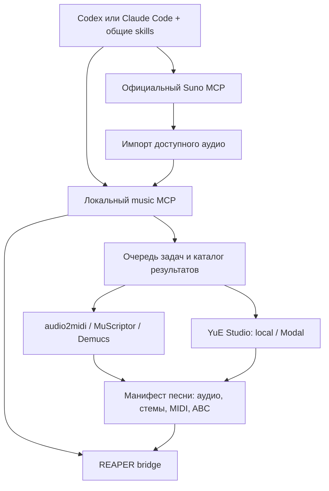

# Музыкальный набор для Codex и Claude Code

Статус: предложение от 01.11.2026. Общий установщик и MCP-адаптеры ниже ещё
не реализованы. Рабочая основа форка — мост REAPER и skill `reaper-control`.

## Что сможет пользователь

Скачать набор, выбрать Codex или Claude Code, пройти диагностику и открыть
свой аудиофайл либо проект REAPER. Базовый сценарий работает без генеративных
моделей. Генерация и тяжёлый анализ устанавливаются отдельными модулями.

| Модуль | Что включить | Что уже есть / что осталось |
|---|---|---|
| REAPER | Снимок проекта, дорожки, MIDI, FX, routing, automation, render | В этом форке проверены транспорт и диагностика; остальные обёртки требуют отдельных проверок |
| Библиотека звуков | Обнаружение VST/AU/CLAP, FX chains, шаблонов; подбор доступных инструментов | Есть `reaper-plugins`; убрать привязки к личному набору и дать варианты на штатных средствах REAPER |
| Аудио → проект | Импорт аудио и стемов, карта темпа, регионы, выравнивание | Основа `audio2midi/scripts/suno_project.py`; обобщить на любой источник, вынести пути и пресеты |
| Анализ и MIDI | Ударные, бас, гитара, аккорды, метрики качества | Есть тракт audio2midi; обернуть CLI с версией алгоритма и явными единицами времени |
| MuScriptor | Полифоническая транскрипция, сравнение с профильными алгоритмами | Локальный CLI интегрирован в сборку проектов; отдельное окружение, загрузка весов и проверка памяти |
| Разделение источников | Demucs, впоследствии другие проверенные модели | Отдельный worker/окружение; качество разделения проверять на выходном аудио |
| YuE | Генерация и продолжение, варианты, ABC-партитура, локальный/Modal движок | В yue-studio есть API, очередь и хранилище; нужен адаптер к этим операциям |
| Suno | Облачная генерация и операции, реально доступные аккаунту | Есть официальный удалённый MCP; подключение и фактические схемы инструментов здесь не проверены |
| Сведение | Анализ спектра/LUFS/пиков, подбор FX, проверка до/после | Есть reaper-mix; нужны переносимые пресеты и варианты без платных плагинов |
| Текст и композиция | Структура песни, партии, текст, ABC/MIDI | Переиспользовать reaper-song/yue-score/yue-song; текстовый модуль включать после проверки его ресурсов и лицензий |

## Общая схема

Один устанавливаемый набор может подключать несколько MCP. На первом этапе
Suno авторизуется напрямую в клиенте: набор не хранит и не проксирует его
OAuth-токены. Единый MCP-шлюз для Suno рассматривать после проверки протокола,
обновления авторизации, доступных операций и условий сервиса.

Предлагаемые группы инструментов (не существующие имена API): `system`,
`assets`, `jobs`, `audio`, `score`, `project`, `reaper`. Для генераторов —
адаптеры с обнаружением возможностей. Отсутствие GPU, модели или аккаунта
выключает соответствующую возможность и даёт конкретную инструкцию установки.

Долгие операции возвращают ID задачи: статус, прогресс, отмена, результат,
возобновление после перезапуска. Повтор запроса не должен повторно списывать
кредиты или создавать дубли. Перед облачным запуском показывать доступную
оценку расходов; неизвестную стоимость не подменять нулём. Тяжёлые локальные
модели запускать по бюджету памяти, по умолчанию последовательно.

## Связь Suno, YuE и REAPER

| Сценарий | Путь |
|---|---|
| Разобрать готовую песню | Импорт → стемы → темп → транскрипция → проект REAPER |
| Доработать партию | MIDI из REAPER → ABC → валидация/диапазоны/гармония → YuE → аудио на новой дорожке |
| Сочинить с нуля | Текст/структура → Suno или YuE → выбор варианта → импорт → аранжировка |
| Заменить одну партию | Выделенный диапазон/стем → партитура или референс → генерация → выравнивание и сравнение |

Suno не считать источником редактируемой партитуры: транскрипция его аудио —
приближение. Для YuE сохранять исходную ABC рядом с рендером. Круговой перенос
ABC ↔ MIDI требует явных правил для голосов, темпа, размера и неподдерживаемых
артикуляций; обещать сохранение всех деталей пока нельзя.

Манифест песни должен хранить относительные пути, хеши, происхождение,
версии алгоритмов и моделей, sample rate, карту темпа/размера, начало и сдвиг
каждого файла, связь исходника и производных. Секунды, QN и PPQ не смешивать.
Изменение исходника делает зависимые результаты устаревшими. Повторный импорт
обновляет выбранный результат, не перезаписывает ручные правки музыканта.

## Установка и переносимость

| Профиль | Состав |
|---|---|
| Базовый | MCP, общие skills, диагностика REAPER, MIDI/импорт; без весов и облачных расходов |
| Анализ | FFmpeg, audio2midi и выбранные модели разделения/транскрипции |
| Генерация | YuE local или Modal и/или подключение Suno |

Один исходник каждого `SKILL.md`, установка в каталог выбранного клиента;
различия конфигураций и авторизации — в адаптерах установщика. Поддержку
Claude Code проверять отдельно от настольного Claude: одинаковый формат
инструкций не означает одинаковые возможности локального исполнения.

Установщик должен находить REAPER resource path, архитектуру, Python и FFmpeg,
создавать изолированные окружения и дополнять конфигурацию клиента с резервной
копией. Не переносить чужие абсолютные пути и окружения из git. Сейчас upstream
содержит tracked `.venv*`: перед выпуском набора исключить их из дистрибутива.

YuE и Demucs уже требуют разных Python-зависимостей в локальном стеке;
не собирать их принудительно в один venv. Убрать зависимости от личных
FX chains, сэмплов соседнего веб-проекта, токенов и каталогов пользователя.
Первой проверенной платформой может быть macOS ARM64; Windows и Linux
помечать поддержанными только после проверки на чистой машине.

## Что распространять

| Компонент | Граница набора |
|---|---|
| Этот форк и JSON-парсер | MIT; сохранить исходные лицензии и уведомления |
| REAPER и коммерческие VST | Проверка наличия и ссылки установки; не включать чужие бинарники и лицензии |
| SWS, ReaPack, JS_ReaScriptAPI | Установка подходящих официальных выпусков отдельно; фиксировать версию, источник и лицензию |
| MuScriptor | Код и веса учитывать отдельно: у весов CC BY-NC 4.0 и условия доступа; не считать свободным коммерческим компонентом |
| YuE2 | Проверять лицензии закреплённой версии кода и весов; для весов есть дополнительные разрешения индивидуальным авторам, не общая лицензия для компаний |
| Suno и Modal | Аккаунт и оплата пользователя; в наборе нет ключей, кредитов и обещания доступности сервиса |
| Пресеты, сэмплы, демо | Только собственные или явно разрешённые для распространения |

Для каждого дополнительного модуля нужен манифест зависимостей: версия,
источник, контрольная сумма, лицензия, объём загрузки и требования к ресурсам.
Веса загружать отдельно после принятия пользователем условий источника.

## Порядок разработки и критерии готовности

1. **Переносимое ядро REAPER.** Установщик, диагностическая команда, конфигурация
   обоих клиентов; чистая установка читает тестовый проект без изменения его состояния.
2. **Аудио → REAPER.** Один открытый демофайл превращается в переносимую папку
   песни; темп и смещения проверены, повторный запуск не дублирует дорожки.
3. **Очередь и модели.** Отмена/перезапуск не теряют результаты; неудачная
   загрузка модели и нехватка памяти дают понятную ошибку, а не повреждённый проект.
4. **YuE и Suno.** YuE через существующий API; Suno после входа — инвентаризация
   инструментов и проверка получения аудио. Стемы, скачивание и Voices не обещать
   по одному рекламному списку: проверить права аккаунта и реальные ответы.
5. **Комплект для другого человека.** Инструкции и тест на чистой машине без
   личных путей автора; демонстрационный сценарий для каждого заявленного клиента.

До этих проверок форк — рабочая основа и план, а не готовый универсальный пакет.

## Проверенные источники

- [Официальный Suno MCP](https://suno.com/mcp): endpoint `https://api.suno.com/mcp`,
  вход в аккаунт, собственные кредиты и библиотека. [Инструкция Beta](https://help.suno.com/en/articles/14551425).
- [YuE upstream](https://github.com/multimodal-art-projection/YuE) и
  [лицензия весов](https://github.com/multimodal-art-projection/YuE/blob/main/MODEL_LICENSE).
- [Карточка весов MuScriptor](https://huggingface.co/MuScriptor/muscriptor-large/blob/main/README.md).
- [REAPER ReaScript API](https://www.reaper.fm/sdk/reascript/reascripthelp.html).

Локально изучены README/API yue-studio, MUSCRIPTOR.md и scripts/suno_project.py
в audio2midi, skills yue-score/yue-song/suno-project/reaper-plugins. Suno
не подключался, облачные генерации не запускались, кредиты не расходовались.
